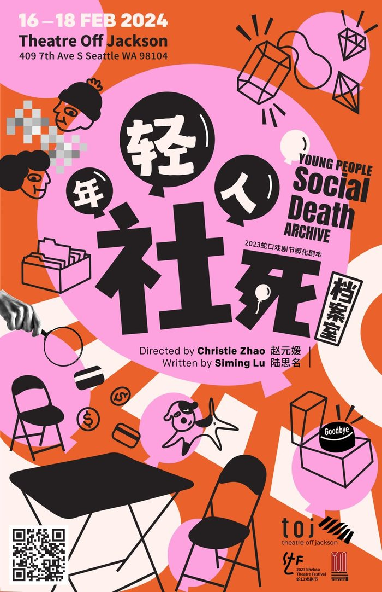

# Production Details
- Produced by: [Yun Theatre](https://yun-theatre.com/)
- Written by: [Siming Lu](https://siminglu.com/)
- Directed by: [Christie Zhao](https://www.christiezhao.com/)
- Set Design by: Junfu (Albert) Chen
- Costume Design by: [Kikyou Yan](https://kikyouyan.com/)
- Light Design by: [Van Liu](https://richthofen.io/)
- Sound Design by: [Renzi Li](https://www.lirenzi.com/)
- Performed at: [Theatre Off Jackson](https://theatreoffjackson.org/), Seattle, WA, USA
- Performed on: Feburary 16th-18th, 2024 (4 show)
- Official web page: [https://yun-theatre.com/ypsda/](https://yun-theatre.com/ypsda/)
- Media coverage:
  - [Seattle Times](https://www.seattletimes.com/entertainment/theater/seattles-yun-theatre-takes-on-intersection-of-chinese-and-american-stories/)
  - [Broadway World](https://www.broadwayworld.com/seattle/article/-YOUNG-PEOPLE-SOCIAL-DEATH-ARCHIVE-Explores-The-Complexity-And-Loneliness-Of-Growing-Up-20240125)
  - [Everout Seattle](https://everout.com/seattle/events/nian-qing-ren-she-si-dang-an-shi-young-people-social-death-archive/e167614/)
  - [NWTheatre](https://nwtheatre.org/event/young-people-social-death-archive-yun-theatre-seattle/)

# Plot
"I don't know why I have so many bizarre behaviors and thoughts. I envy those grown-ups who look cool, who don't cry, who are owners of kittens and puppies, and who don't have to spend their days divining the whereabouts of their former lovers with tarot cards. My question is: how can I become a grown-up?"

# Videos
**Rehearsal Footage 排练现场**



**Interview with Director Christie Zhao 导演访谈**



**Say Goodbye**



**Dance Party**



Videos by [Yun Theatre](https://www.youtube.com/channel/UC39S5rHT3YRqzLoxxsSTmiA).

# Photos
Photos from the [Yun Theatre website](https://yun-theatre.com/ypsda/).

{% include carousel.html height=56.25 unit="%" duration="5" %}
