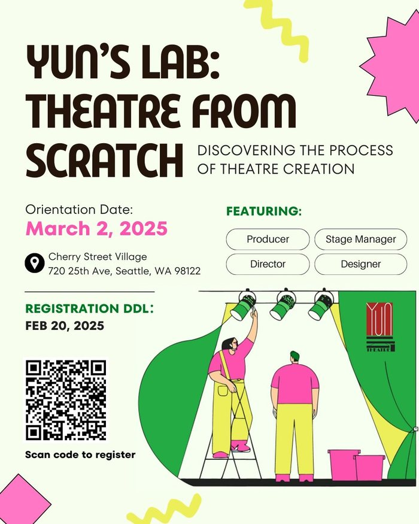
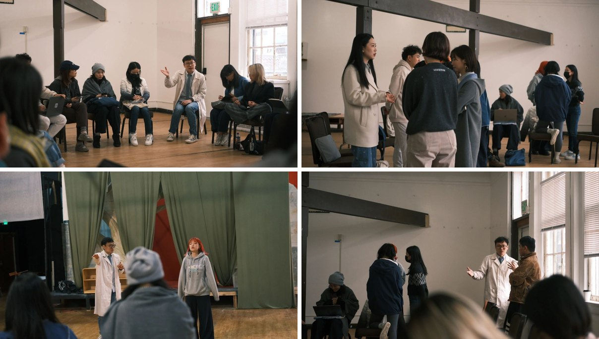
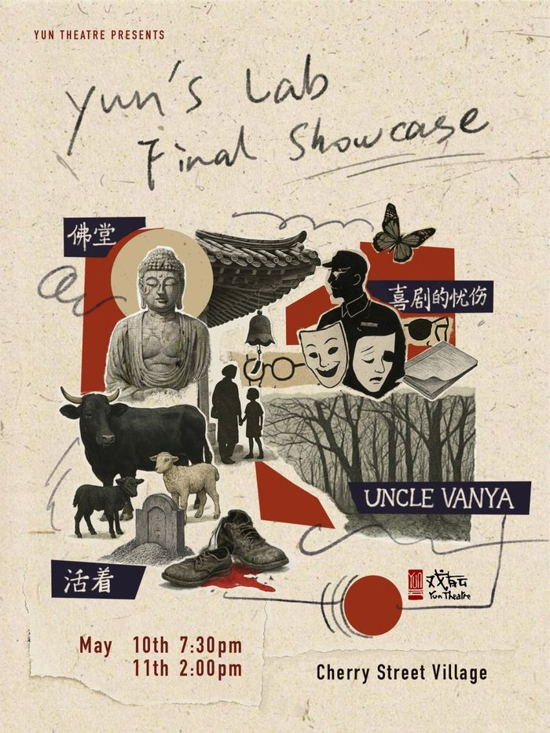
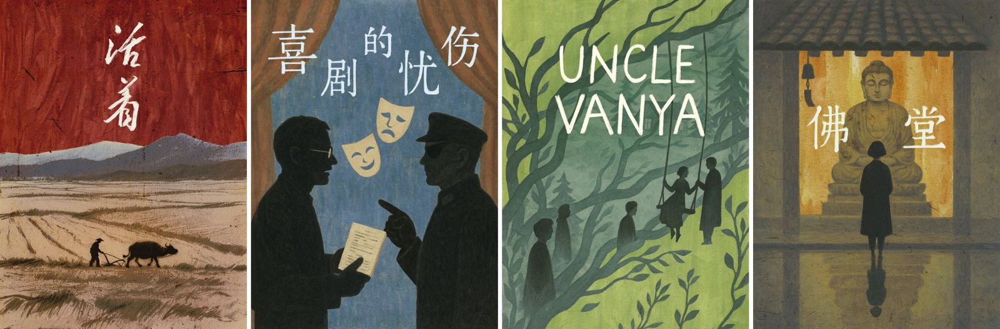
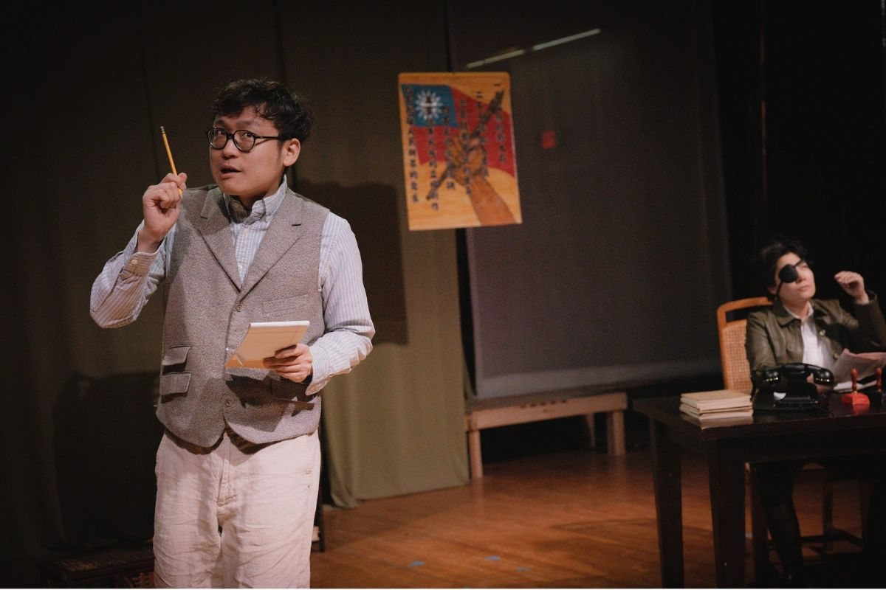

Yun's Lab is **not a show, it is a program**: a 12-week theatre education program that Yun Theatre ran for the first time in the spring of 2025. The Final Showcase at the end is only one piece of it, the moment where what the participants learned gets put on a stage. I co-produced the program, and I also acted in the showcase.

# Program Details
- Organized by: [Yun Theatre](https://yun-theatre.com/)
- Program: Yun's Lab: Theatre from Scratch, a hands-on, 12-week theatre education program (taught in Mandarin, with some scripts in English)
- Program period: March 2nd - May 18th, 2025 (orientation on March 2nd)
- Participants: 24 students
- Held at: Cherry Street Village (720 25th Ave), Seattle, WA, USA
- Final Showcase: May 10th (7:30 PM) and May 11th (2:00 PM), 2025 (2 shows, both sold out)
- Official web page: [https://yun-theatre.com/yuns-lab](https://yun-theatre.com/yuns-lab)
- Curriculum: [Yun's Lab curriculum (Google Doc)](https://docs.google.com/document/d/1yfJ9adCS5TYc9mhAGdJ4Xbdeeun39EkA2Ps4qnjsvUs/edit)
- Showcase program: [Final Showcase Program (PDF)](https://img1.wsimg.com/blobby/go/5aafb59c-062f-4c9c-a8af-399d442bb464/downloads/ae51b187-212c-4575-8d6f-af6cee9515c4/Yun_s%20Lab%20Final%20Showcase%20Program.pdf)

# My Role
> Co-producing a *program* is a different job from producing a *show*. A show producer works towards one script and one opening night. A program co-producer designs the whole learning journey: what participants should learn, in what order, from whom, and how they get to practice it, and then makes sure the showcase can happen at the end of it.

- **Program Co-Producer** (together with Samantha Yang)
  - Put together the whole 12-week curriculum, and organized and ran the courses
  - Invited domain experts to give lectures and seminars as the program's mentors
  - Checked the program booklet, the marketing, and everything else that went into the public showcase
- **Cast**: the Playwright (编剧) in the participants' production of *The Last Laugh / 喜剧的忧伤*, opposite Zoe Ding as the Censorship Officer

# Why Yun's Lab
The idea started from a chance conversation with [Christie Zhao](https://www.christiezhao.com/), Yun Theatre's Artistic Director. I have no formal theatre degree and no systematic training. Most of what I know came from the years at NUS KEVII Chinese Drama in Singapore, where I directed, acted, and worked on stage and lighting design, and from an acting class at CMU where theatre majors and non-majors shared one room and learned different things from different seats. Christie asked whether we could build something like that. After months of hesitation and preparation, the first Yun's Lab started.

The program welcomes people with little or no theatre experience. The goal is to show how a theatre production really works: how it goes from an idea to something on a stage, what the stages in between are, and which departments and roles make it happen. Every participant takes a specific role on a team, and the roles cover:

- Script selection and text analysis
- Directing
- Producing
- Stage management
- Set design
- Costume design
- Lighting design
- Sound design
- Casting and acting
- Board operation

# Curriculum
The three phases move from learning the roles, to trying them on a small scale, to running a production from scratch.

| Phase | Weeks | What happens |
|-------|-------|--------------|
| 1. Basics | 1-5 | Orientation, text analysis, directing, producing, and designing (lighting, costume, sound) |
| 2. Theory to practice | 6-7 | Staged reading: team assignment, load-in, showcase, and strike |
| 3. Production from scratch | 8-12 | Team assignment, checkpoints with the instructors, the public showcase and strike (week 11), and a retro review with feedback (week 12) |

Participants were expected to spend roughly 3 hours in class each week plus up to 4 hours of work outside of class.

# The Lab Team
The mentors, as listed in the showcase program:
- [Christie Zhao](https://www.christiezhao.com/): Director & Producer
- Zoe Ding: Producer
- Tianxing Yan: Costume Design
- Albert Chen: Set Design
- Renzi Li: Sound Design
- Samantha Yang: Stage Management & Light Design, and Co-Producer of Yun's Lab

# The Final Showcase
After more than two months of study, the 24 participants divided into four teams. Each team ran a short production from scratch, with student directors, producers, stage managers, designers, and casts. Both public shows sold out.

## 活着 / To Live
Adapted from Yu Hua's novel. The story of Fugui, an ordinary farmer who struggles through sweeping historical changes and personal tragedies. Through his perseverance and sense of responsibility, the play explores how one holds on to hope and family even in the face of despair.

## 喜剧的忧伤 / The Last Laugh
> I played the **Playwright** in this one

Adapted from Koki Mitani's *University of Laughs* (笑の大学), moved to China during the War of Resistance against Japan. An exiled comedy troupe's playwright submits a new script for wartime censorship. In a darkly funny rewriting session, the playwright and the censor slowly stop being opponents and become co-creators.

## 万尼亚舅舅 / Uncle Vanya
A multilingual adaptation of Chekhov's play, performed across six languages: Russian, Japanese, Thai, Mandarin, Cantonese, and English. The director's experiment was to create a "perfect world" where everyone speaks their mother tongue.

## 佛堂 / Buddha Hall
Directed by Harvey Yang and produced by Tina Deng. A town's Buddha hall is full of pilgrims asking for worldly wishes: wealth, power, sons. One child wants something different and sets off on a journey of her own, and at the end of the long road she understands the meaning and the price of it. The Wanderer was played by Lisa Zhang and the Child by Tina Deng.

Photos from the [Yun Theatre website](https://yun-theatre.com/yuns-lab). The showcase photographer credited in the program is Elodie Li.

# Final Notes
Before this, Yun Theatre's performance workshops were a few hours on a weekend afternoon. Yun's Lab was the first time we stretched that into a multi-month program, and the first edition ran with 24 participants. It was deeply rewarding to watch people who had never been backstage take on a role, make real decisions with a team, and then bring their work into a theatre in front of an audience.

{% include carousel.html height=65 unit="%" duration="5" %}
