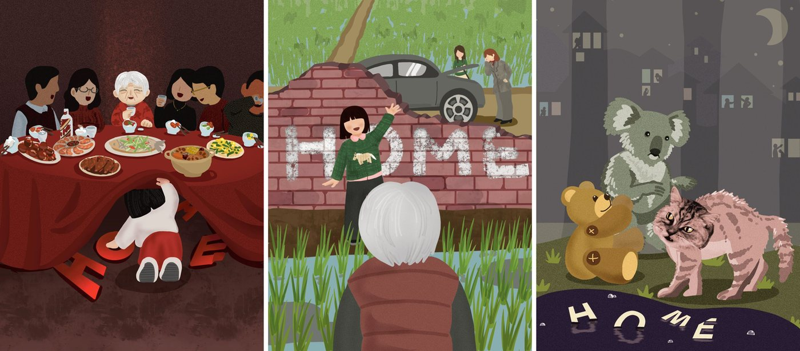

# Production Details
- Produced by: [Yun Theatre](https://yun-theatre.com/)
- Directed by: Harvey Yang (Associate Director: [Renzi Li](https://www.lirenzi.com/))
- Playwrights: Harvey Yang, Renzi Li, Eddy Xin
- Producer: Elodie Li
- Stage Manager: Iris Chen
- Performed at: BASE: Experimental Arts + Space, Seattle, WA, USA
- Performed on: October 25th, 2026 (2:00 PM)
- Official web page: [https://yun-theatre.com/home](https://yun-theatre.com/home)

# My Role
- Cast (staged reading)

# Concept
*Home* is a staged reading of three original short scripts about family and belonging, developed through a devising workshop. This was a staged reading, not a full production.

# Short Plays
- A New Year's Eve dinner with Grandma
- Mu visits her grandmother
- Tommy (汤汤), a plush bear

# Cast
Kefan Yi, Lisa Zhang, Lux Zhao, Sebastian Wang, Van Liu, Xinran Wang, Yihan Lin, Zoe Ding

Photos from the [Yun Theatre website](https://yun-theatre.com/home), taken during rehearsals and the reading.

{% include carousel.html height=65 unit="%" duration="5" %}
